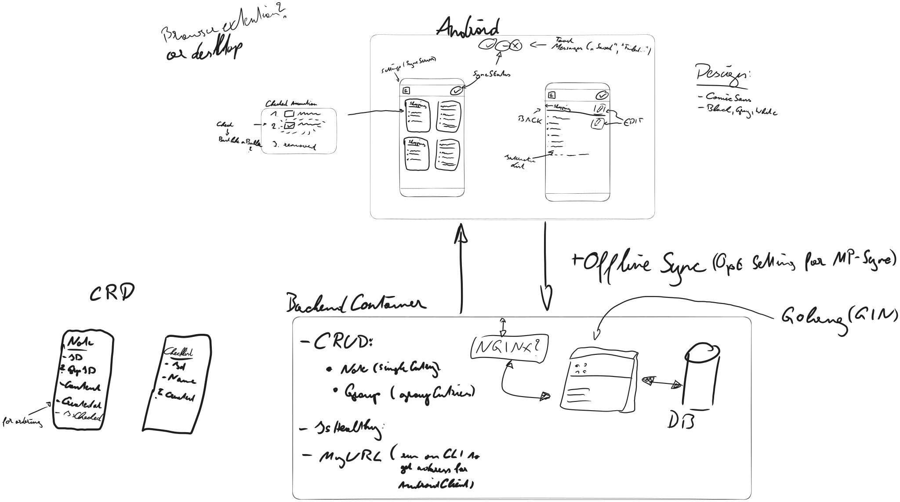

# SimNotes

A self-hosted notes and checklist app for Android and the browser, with offline editing on Android.

**Status:** Early design. The first milestone is a shared shopping list.


## First Architecture Scetch


## Running the API

From the project root, after installing dependencies with `uv sync`:

```powershell
.\.venv\Scripts\fastapi.exe dev .\src\api\main.py
```

Open http://127.0.0.1:8000/docs to try the API interactively.
GET http://127.0.0.1:8000/ is a simple liveness healthcheck returning
HTTP 200 with `{"status": "ok"}` when the API is running.

This prototype stores data in memory, starting with two sample checklists.
Changes reset when the server restarts or reloads. Run one server worker;
each worker would have its own independent data.

## CRUD endpoints

| Method | Path | Action |
| --- | --- | --- |
| GET | /checklists | List checklists with their notes |
| POST | /checklists | Create a checklist |
| GET | /checklists/{checklist_id} | Read a checklist |
| PUT | /checklists/{checklist_id} | Rename a checklist |
| DELETE | /checklists/{checklist_id} | Delete a checklist and its notes |
| GET | /checklists/{checklist_id}/notes | List notes in a checklist |
| POST | /checklists/{checklist_id}/notes | Create a note |
| GET | /checklists/{checklist_id}/notes/{note_id} | Read a note |
| PUT | /checklists/{checklist_id}/notes/{note_id} | Replace a note's editable fields |
| DELETE | /checklists/{checklist_id}/notes/{note_id} | Delete a note |
| GET | /notes | List all notes as `{"notes": [...]}` |

For checklist creation and updates, send `{"name": "Shopping"}`.
For note creation and updates, send `{"content": "Milk", "is_checked": false}`.
The server assigns IDs and creation timestamps. Names and content must not be
blank; unknown fields are rejected. A PUT replaces the editable fields:
omitting `is_checked` sets it to `false`. IDs, timestamps, and existing checklist
notes are preserved on update. New timestamps use UTC.

Creation returns 201, deletion returns 204 with an empty body, and missing
checklists or notes return 404. Invalid request bodies return 422.

## Tests

Run the full API test suite from the project root:

```powershell
.\.venv\Scripts\python.exe -B -m unittest discover -s tests -v
```
